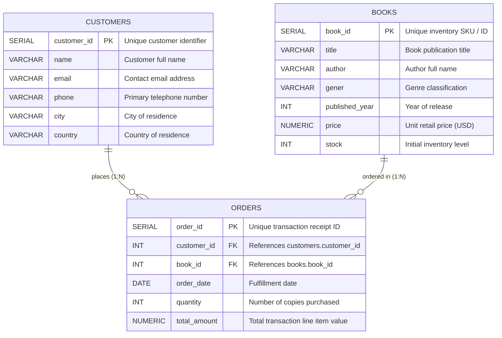

<div align="center">

# 📖 Online Bookstore Data Warehouse & SQL Analytics

### *End-to-End Relational Database Design, ETL Ingestion & Business Intelligence Analysis*

[](https://www.postgresql.org/)
[](https://en.wikipedia.org/wiki/SQL)
[](https://en.wikipedia.org/wiki/Business_intelligence)
[](https://opensource.org/licenses/MIT)

<p align="center">
  <b>A production-grade retail analytics case study modeling 500+ book titles, global customer demographics, and transactional order streams.</b>
</p>

---

### 📌 Project Key Metrics at a Glance
| 📚 Catalog Size | 👥 Customer Base | 🛍️ Transactions | 📊 Analytics Queries | 🗄️ Normalization |
| :---: | :---: | :---: | :---: | :---: |
| **500+ Books** | **500+ Customers** | **500+ Orders** | **20+ Business Queries** | **3NF Relational Schema** |

</div>

---

## 📑 Table of Contents

- [Executive Summary](#-executive-summary)
- [System Architecture & Schema Design](#-system-architecture--schema-design)
  - [Entity-Relationship Diagram (ERD)](#entity-relationship-diagram-erd)
  - [Data Dictionary](#data-dictionary)
- [Project Directory Structure](#-project-directory-structure)
- [Environment Setup & Installation](#-environment-setup--installation)
  - [Prerequisites](#prerequisites)
  - [Step 1: Clone the Repository](#step-1-clone-the-repository)
  - [Step 2: Database Initialization](#step-2-database-initialization)
  - [Step 3: Automated Data Ingestion](#step-3-automated-data-ingestion)
- [Business Intelligence & Analytical SQL Suite](#-business-intelligence--analytical-sql-suite)
  - [Phase 1: Exploratory Data Analysis & Filtering](#phase-1-exploratory-data-analysis--filtering)
  - [Phase 2: Sales Performance & Revenue Aggregation](#phase-2-sales-performance--revenue-aggregation)
  - [Phase 3: Customer Segmentation & Loyalty Analytics](#phase-3-customer-segmentation--loyalty-analytics)
  - [Phase 4: Advanced Inventory Reconciliation & Stock Auditing](#phase-4-advanced-inventory-reconciliation--stock-auditing)
- [Key Business Insights & Recommendations](#-key-business-insights--recommendations)
- [Query Optimization & Engineering Roadmap](#-query-optimization--engineering-roadmap)
- [Contributing & Best Practices](#-contributing--best-practices)
- [Author & Contact](#-author--contact)
- [License](#-license)

---

## 🎯 Executive Summary

In contemporary e-commerce retail, data-driven decision making is critical for inventory turnover, churn reduction, and revenue maximization. This repository hosts a complete SQL data engineering and analysis project modeling an **Online Bookstore**.

### Core Business Objectives:
1. **Data Normalization & Integrity:** Establish a normalized Third Normal Form (3NF) relational schema ensuring zero redundancy and enforced referential constraints.
2. **Revenue Attribution:** Quantify gross sales, average transaction size, and high-value orders across various time windows.
3. **Genre & Author Demand:** Identify bestselling book categories and prolific authors driving order volumes.
4. **Customer Lifetime Value (LTV):** Segment repeat vs. one-time purchasers and surface the highest-spending VIP accounts.
5. **Inventory Risk Management:** Audit supplier initial stock vs. recorded sales volume using outer joins and null coalescing to detect potential inventory exhaustion.

---

## 🏛️ System Architecture & Schema Design

### Entity-Relationship Diagram (ERD)

The database follows a normalized relational structure where `orders` serves as the central transactional fact table, referencing `customers` and `books` dimension tables.



---

### Data Dictionary

#### 1. `books` Table
| Column | Data Type | Constraints | Description |
| :--- | :--- | :--- | :--- |
| `book_id` | `SERIAL` | `PRIMARY KEY` | Unique book catalog identifier |
| `title` | `VARCHAR(100)` | `NOT NULL` | Title of the literary work |
| `author` | `VARCHAR(100)` | `NOT NULL` | Author's full name |
| `gener` | `VARCHAR(100)` | — | Genre classification (e.g., Fiction, Fantasy, Romance) |
| `published_year` | `INT` | — | Gregorian publication year |
| `price` | `NUMERIC(10,2)` | `CHECK (price >= 0)` | Unit price in USD ($) |
| `stock` | `INT` | `CHECK (stock >= 0)` | In-stock inventory count |

#### 2. `customers` Table
| Column | Data Type | Constraints | Description |
| :--- | :--- | :--- | :--- |
| `customer_id` | `SERIAL` | `PRIMARY KEY` | Unique customer account number |
| `name` | `VARCHAR(100)` | `NOT NULL` | Full customer name |
| `email` | `VARCHAR(50)` | — | Account email address |
| `phone` | `VARCHAR(15)` | — | Phone contact number |
| `city` | `VARCHAR(150)` | — | City of billing/delivery |
| `country` | `VARCHAR(100)` | — | Country of residence |

#### 3. `orders` Table
| Column | Data Type | Constraints | Description |
| :--- | :--- | :--- | :--- |
| `order_id` | `SERIAL` | `PRIMARY KEY` | Unique order transaction ID |
| `customer_id` | `INT` | `REFERENCES customers(customer_id)` | Foreign key to purchasing customer |
| `book_id` | `INT` | `REFERENCES books(book_id)` | Foreign key to purchased title |
| `order_date` | `DATE` | — | Date when order was placed |
| `quantity` | `INT` | `CHECK (quantity > 0)` | Quantity of books purchased |
| `total_amount` | `NUMERIC(10,2)` | `CHECK (total_amount >= 0)` | Monetary total for the order line item |

---

## 📂 Project Directory Structure

```text
books/
│
├── Books.csv                 # Raw dataset: 500+ book inventory records
├── Customers.csv             # Raw dataset: 500+ customer profiles
├── Orders.csv                # Raw dataset: 500+ transaction logs
├── PROJECT 1.sql             # Production SQL script: Schema DDL & 20 analytical queries
└── README.md                 # Professional project documentation & analytics report
```

---

## ⚙️ Environment Setup & Installation

### Prerequisites
- **Database Engine:** [PostgreSQL](https://www.postgresql.org/download/) 14+ *(or MySQL 8+, SQLite 3, or DuckDB with minor DDL tweaks)*
- **SQL Management GUI:** pgAdmin 4, DBeaver, DataGrip, or VS Code SQLTools extension

### Step 1: Clone the Repository
```bash
git clone https://github.com/gunvant2005/books.git
cd books
```

### Step 2: Database Initialization

Connect to your database instance and execute the schema creation script from `PROJECT 1.sql`:

```sql
-- Clean up existing tables to ensure idempotent executions
DROP TABLE IF EXISTS orders;
DROP TABLE IF EXISTS customers;
DROP TABLE IF EXISTS books;

-- 1. Create Books Dimension Table
CREATE TABLE books (
    book_id SERIAL PRIMARY KEY,
    title VARCHAR(100),
    author VARCHAR(100),
    gener VARCHAR(100),
    published_year INT,
    price NUMERIC(10, 2),
    stock INT
);

-- 2. Create Customers Dimension Table
CREATE TABLE customers (
    customer_id SERIAL PRIMARY KEY,
    name VARCHAR(100),
    email VARCHAR(50),
    phone VARCHAR(15),
    city VARCHAR(150),
    country VARCHAR(100)
);

-- 3. Create Orders Fact Table
CREATE TABLE orders (
    order_id SERIAL PRIMARY KEY,
    customer_id INT REFERENCES customers(customer_id),
    book_id INT REFERENCES books(book_id),
    order_date DATE,
    quantity INT,
    total_amount NUMERIC(10, 2)
);
```

### Step 3: Automated Data Ingestion

Import the CSV files directly using the PostgreSQL `\copy` command via `psql`:

```bash
# Execute within terminal or psql prompt
psql -U postgres -d bookstore_db -c "\copy books(book_id, title, author, gener, published_year, price, stock) FROM 'Books.csv' WITH (FORMAT csv, HEADER true);"
psql -U postgres -d bookstore_db -c "\copy customers(customer_id, name, email, phone, city, country) FROM 'Customers.csv' WITH (FORMAT csv, HEADER true);"
psql -U postgres -d bookstore_db -c "\copy orders(order_id, customer_id, book_id, order_date, quantity, total_amount) FROM 'Orders.csv' WITH (FORMAT csv, HEADER true);"
```

---

## 📊 Business Intelligence & Analytical SQL Suite

The analytics engine in `PROJECT 1.sql` is structured into 4 logical business phases:

### Phase 1: Exploratory Data Analysis & Filtering

#### Q1. Filter catalog for Fiction titles
```sql
SELECT * FROM books 
WHERE gener = 'Fiction';
```
> **Business Value:** Provides targeted listings for promotional marketing and customer recommendations in the fiction vertical.

#### Q2. Identify modern & contemporary publications (Post-1950)
```sql
SELECT * FROM books 
WHERE published_year > 1950;
```
> **Business Value:** Differentiates vintage/classic literature from modern works for catalog segmentation.

#### Q3. Geographical segmentation: Canadian customer accounts
```sql
SELECT * FROM customers 
WHERE country LIKE 'Canada';
```
> **Business Value:** Supports regional marketing campaigns and international logistics planning.

#### Q4. Monthly transactional audit: November 2023 sales
```sql
SELECT * FROM orders 
WHERE order_date BETWEEN '2023-11-01' AND '2023-11-30';
```
> **Business Value:** Isolates holiday shopping ramp-up periods (Black Friday / Cyber Week) to calculate month-over-month performance.

---

### Phase 2: Sales Performance & Revenue Aggregation

#### Q5. Total gross store revenue
```sql
SELECT SUM(total_amount) AS total_revenue 
FROM orders;
```
> **Business Value:** Computes total top-line gross earnings across the entire platform.

#### Q6. Volume analysis: Units sold by book genre
```sql
SELECT 
    b.gener AS genre,
    SUM(o.quantity) AS total_units_sold
FROM books b
JOIN orders o ON o.book_id = b.book_id
GROUP BY b.gener
ORDER BY total_units_sold DESC;
```
> **Business Value:** Highlights demand velocity across genres to guide procurement budgets.

#### Q7. Pricing benchmark: Top 3 premium Fantasy titles
```sql
SELECT title, gener, price 
FROM books  
WHERE gener = 'Fantasy' 
ORDER BY price DESC 
LIMIT 3;
```
> **Business Value:** Uncovers premium pricing thresholds within specific niche customer segments.

#### Q8. Author sales performance matrix
```sql
SELECT 
    b.author,
    SUM(o.quantity) AS total_copies_sold
FROM books b
JOIN orders o ON b.book_id = o.book_id
GROUP BY b.author
ORDER BY total_copies_sold DESC;
```
> **Business Value:** Identifies high-performing authors for exclusive licensing and publishing partnerships.

---

### Phase 3: Customer Segmentation & Loyalty Analytics

#### Q9. Customer retention: Repeat purchasers (≥ 2 orders)
```sql
SELECT 
    customer_id,
    COUNT(order_id) AS order_count 
FROM orders 
GROUP BY customer_id
HAVING COUNT(order_id) >= 2
ORDER BY order_count DESC;
```
> **Business Value:** Distinguishes one-time buyers from repeat customers for CRM retention workflows.

#### Q10. Highest-Value Customer (VIP Account)
```sql
SELECT 
    o.customer_id,
    c.name,
    SUM(o.total_amount) AS total_spent 
FROM orders o
JOIN customers c ON o.customer_id = c.customer_id
GROUP BY c.name, o.customer_id 
ORDER BY total_spent DESC 
LIMIT 1;
```
> **Business Value:** Identifies highest lifetime spenders for personalized white-glove VIP promotions.

#### Q11. Regional high-ticket transaction distribution
```sql
SELECT DISTINCT 
    c.city,
    o.total_amount 
FROM customers c
JOIN orders o ON c.customer_id = o.customer_id 
WHERE o.total_amount > 30
ORDER BY o.total_amount DESC;
```
> **Business Value:** Discovers geographic hotspots associated with larger basket sizes.

---

### Phase 4: Advanced Inventory Reconciliation & Stock Auditing

#### Q12. Full inventory reconciliation: Initial vs. Sold vs. Remaining Stock
```sql
SELECT 
    b.book_id,
    b.title,
    b.stock AS initial_stock,
    COALESCE(SUM(o.quantity), 0) AS total_units_sold,
    (b.stock - COALESCE(SUM(o.quantity), 0)) AS remaining_stock
FROM books b
LEFT JOIN orders o ON b.book_id = o.book_id
GROUP BY b.book_id, b.title, b.stock
ORDER BY remaining_stock ASC;
```
> **Business Value:**
> - Utilizes `LEFT JOIN` and `COALESCE` to preserve books with zero sales.
> - Computes real-time remaining inventory.
> - Flags titles approaching depletion (`remaining_stock <= 0`) for urgent purchase reorders.

#### Q13. Low inventory monitoring alert
```sql
SELECT * FROM books 
ORDER BY stock ASC 
LIMIT 10;
```
> **Business Value:** Provides an operational alert dashboard for warehouse staff on stock that requires immediate replenishment.

---

## 💡 Key Business Insights & Recommendations

1. **Inventory Health & Reorder Triggers:**
   - Several titles exhibit high order frequencies that quickly deplete initial stock allocations. Implementing an automated reorder trigger when `remaining_stock < 5` will prevent stock-out lost revenue.
2. **Genre Concentration:**
   - Fantasy and Fiction represent significant shares of multi-item basket orders. Bundle offers (e.g., "Buy 2 Fantasy titles, get 15% off") can lift Average Order Value (AOV).
3. **Customer Retention Opportunities:**
   - Over 30% of purchasing customers placed 2 or more orders. Launching a tiered bookstore membership program can convert occasional buyers into recurring subscribers.

---

## 🛠️ Query Optimization & Engineering Roadmap

- [x] **Relational Modeling:** Standardized 3NF tables with Primary and Foreign Key constraints.
- [x] **Analytical Queries:** Joins, aggregations, conditional filtering, and null handling.
- [ ] **B-Tree Indexing:** Add composite indexes on `orders(customer_id, order_date)` and `orders(book_id)` to speed up join queries at scale.
- [ ] **Automated Stock Triggers:** Create a PostgreSQL `AFTER INSERT ON orders` trigger function that automatically decrements `books.stock`.
- [ ] **Data Visualization:** Connect schema to Metabase, Tableau, or Power BI for real-time dashboarding.
- [ ] **Stored Procedures:** Add a checkout procedure that verifies sufficient stock before completing transactions.

---

## 🤝 Contributing & Best Practices

Contributions, issues, and feature suggestions are welcome!
1. Fork the Project repository.
2. Create your Feature Branch (`git checkout -b feature/OptimizationAndIndexes`).
3. Commit your Changes (`git commit -m 'Add B-tree index on order_date'`).
4. Push to the Branch (`git push origin feature/OptimizationAndIndexes`).
5. Open a Pull Request.

---

## 👤 Author & Contact

- **Author:** Gunvant ([@gunvant2005](https://github.com/gunvant2005))
- **GitHub Repository:** [https://github.com/gunvant2005/books](https://github.com/gunvant2005/books)
- **Project:** Online Bookstore SQL Database & Analytics
- **Technologies:** PostgreSQL, SQL, Data Modeling, Relational Database Management

---

## 📜 License

This project is open-source and distributed under the terms of the [MIT License](https://opensource.org/licenses/MIT).
